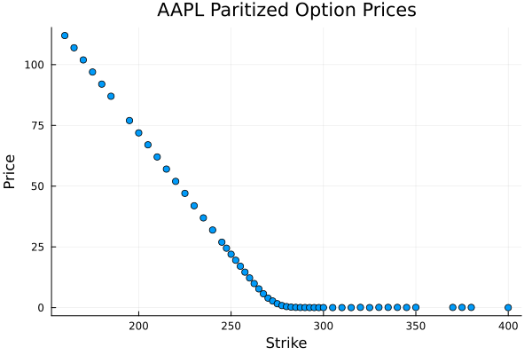
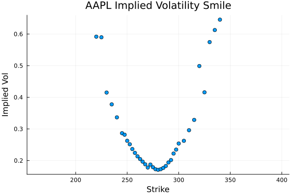
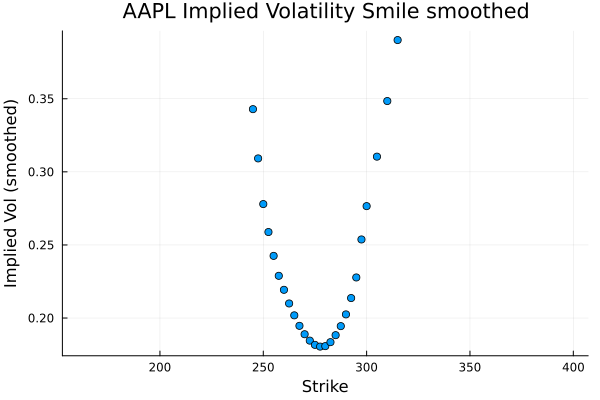
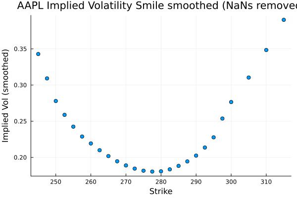
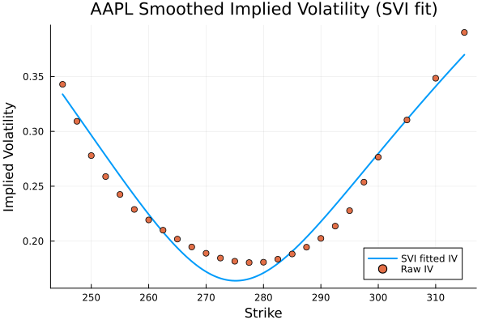
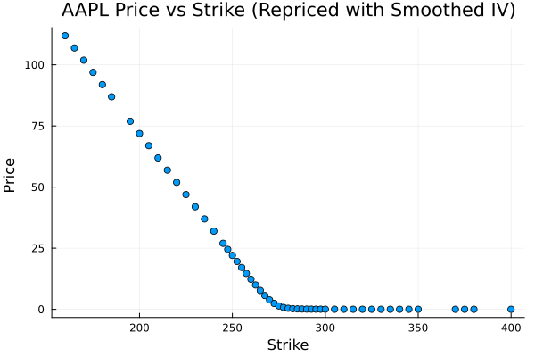
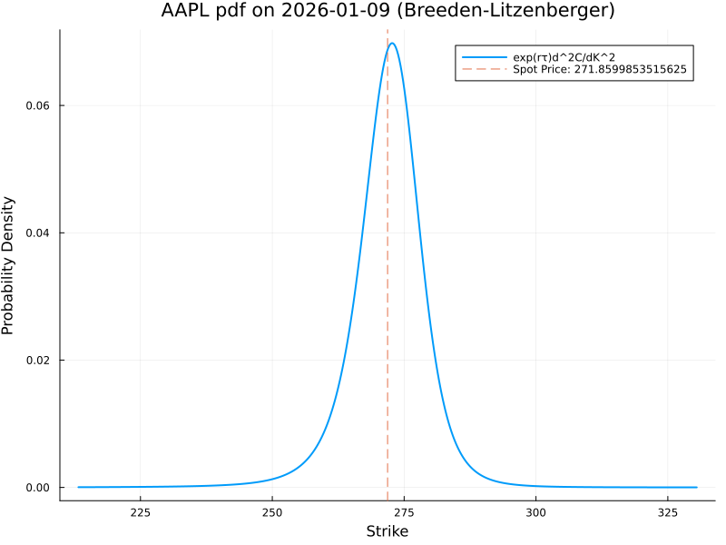
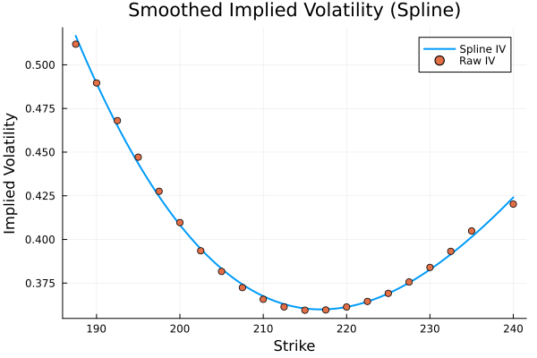
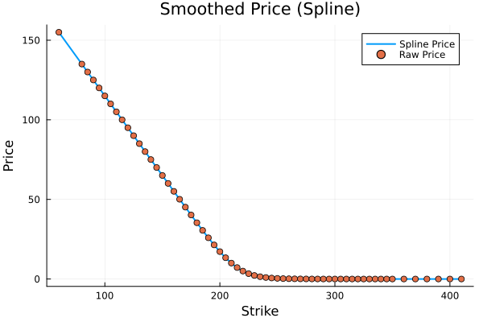
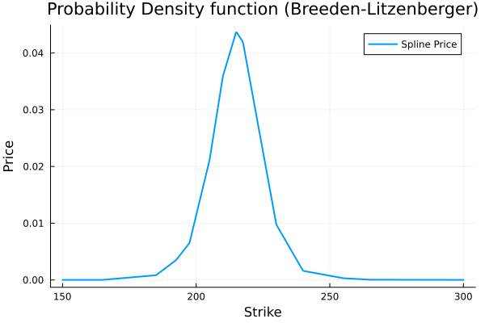

# [Technical background](@id technical-background)

## Overview

OptionsImpliedPDF.jl is a Julia package implementing advanced options pricing models and risk-neutral probability analysis. The package combines real-time market data with sophisticated mathematical models to provide accurate pricing and risk assessment tools.

## Process Overview

The process of generating the PDFs and CDFs is as follows:

1. **Data Acquisition**: For an underlying asset, options data along the full range of strike prices are read from a source file to create a DataFrame. This gives us a table of strike prices along with the last or mid price each option sold for.

2. **Put-Call Parity Preprocessing**: Apply put-call parity to create synthetic call prices from out-of-the-money put prices, reducing noise from illiquid in-the-money quotes.

3. **OTM Filtering**: Restrict to out-of-the-money options only, using yfinance's `inTheMoney` flag (`inTheMoney == false`). OTM call prices are mids; OTM puts become synthetic calls via put-call parity \(C = P + S - K e^{-r\tau}\). There is no dividend yield \(q\).

   

4. **Implied Volatility Calculation**: Using the Black-Scholes-Merton pricing model, convert option prices into implied volatilities (IV). IVs are solved using Newton's method with analytical derivatives.

   

5. **Gaussian Smoothing**: Apply a Gaussian kernel of size 5 over the **row index** (not strike distance): window \(i \pm 5\), weights \(w = \exp(-(i-j)^2 / (2 \cdot 5^2))\). NaNs are not skipped, so a NaN poisons its neighbours; non-finite rows are then dropped. The risk-free rate used throughout is hard-coded to \(r = 0.01\).

   
   

6. **Single-Expiry Smile Fitting**: Fit the smoothed implied-volatility smile with SVI (one expiry; not a volatility surface). During optimization, constrain the raw parameters ($b \geq 0$, $|\rho| \leq \rho_{\text{bound}} < 1$, $\sigma \geq \sigma_{\text{min}}$) and penalize violations of the Gatheral-Jacquier minimum-variance condition $a + b\sigma\sqrt{1-\rho^2} \geq 0$. After calibration, evaluate the butterfly diagnostic $g(k)$ on a log-moneyness grid extended by `k_extend` (default \(0.6\)); if $\min g < 0$ a plain `error()` is raised. There is no calendar-arbitrage check across expiries.

   

7. **Price Curve Generation**: From the fitted volatility smile, use the Black-Scholes-Merton model to generate a continuous curve of option prices along the full range of strike prices.

   

8. **PDF Extraction**: From the continuous price curve, use numerical differentiation to compute the second derivative of call prices with respect to strike. The second derivative multiplied by the discount factor $e^{r\tau}$ gives the risk-neutral probability density function (Breeden-Litzenberger formula).

   

9. **CDF Calculation**: `p_below` is a 10,000-step trapezoid sum of the Breeden–Litzenberger density from \(K = 1\) to the requested strike. The density is not normalized or checked to integrate to 1. `prob_at_or_above = 1 - prob_below`.

## Mathematical Framework

For more details, my handwritten notes can be seen in the `/notes` folder.
- [Implied Probability](https://github.com/SentientPlatypus/OptionsImpliedPDF.jl/blob/main/notes/Implied%20Probability.pdf)
- [Black Scholes](https://github.com/SentientPlatypus/OptionsImpliedPDF.jl/blob/main/notes/Black%20Scholes%20Merton.pdf)

### Black-Scholes Model

The package implements the Black-Scholes model for European options with **no dividend yield** \(q\):

$$
\begin{aligned}
C(S, K, T, r, \sigma) &= S N(d_1) - K e^{-rT} N(d_2) \\
P(S, K, T, r, \sigma) &= K e^{-rT} N(-d_2) - S N(-d_1)
\end{aligned}
$$

Where:

- $d_1 = \frac{\ln(S/K) + (r + \sigma^2/2)T}{\sigma\sqrt{T}}$
- $d_2 = d_1 - \sigma\sqrt{T}$
- $N(\cdot)$ is the cumulative normal distribution
- In `prob_below`, \(r\) is fixed at \(0.01\) and current time \(t = 0\)

Implied volatility is calculated using Newton–Raphson iteration with analytical derivatives.

### SVI (Stochastic Volatility Inspired) Model

The SVI model parameterizes **total variance of a single-expiry smile** in log-moneyness:

$$w(k) = a + b \left( \rho (k - m) + \sqrt{(k - m)^2 + \sigma^2} \right)$$

Where:

- $k = \ln(K/F)$ is log-moneyness
- $F = S e^{rT}$ is the forward price
- $a, b, \rho, m, \sigma$ are SVI parameters

#### Parameter constraints

- $b > 0$
- $|\rho| \leq 1$
- $\sigma > 0$
- $a + b\sigma\sqrt{1-\rho^2} \geq 0$ (Gatheral–Jacquier minimum-variance condition; there is no calendar-arbitrage check across expiries)

#### Reparameterization

For optimization stability, parameters are reparameterized (positivity and bounded $\rho$ via $\tanh$, etc.).

### Why not spline fitting?

Spline interpolation of the smile can violate no-arbitrage, extrapolate poorly, and amplify noise in second derivatives used in Breeden–Litzenberger. The figures below contrast a spline-based experiment with SVI on sample data from this repository.

### Risk-neutral density (Breeden–Litzenberger)

$$q(K) = e^{rT} \frac{\partial^2 C}{\partial K^2}$$

Implementation: fit SVI on the single-expiry smile, price calls off that smile at each quadrature node, approximate \(\partial^2 C/\partial K^2\) with a central second difference (\(h = 0.001\)), then integrate with a 10,000-step trapezoid from \(K = 1\). The density is not normalized or checked to integrate to 1; there is no precomputed dense grid, vectorization, or cache.

## Data pipeline

- **Quotes**: Mid from bid/ask when healthy; otherwise fallback to last trade (with warnings).
- **Parity / OTM**: Keep rows with yfinance `inTheMoney == false`; OTM puts become synthetic calls \(C = P + S - K e^{-r\tau}\).
- **Smoothing**: Gaussian kernel of size 5 over the row index (NaNs propagate); then drop non-finite IV rows.
- **Rate**: \(r = 0.01\) hard-coded; no dividend yield \(q\).
- **Fitting**: Unweighted SSE in total variance (`weights = ones`) with constrained optimization and butterfly \(g(k)\) on a \(k\) grid extended by `k_extend` (default \(0.6\)). Failures raise `error()`, not `CalculationError`. No calendar-arbitrage check.

## Dependencies (Julia)

Julia ≥ 1.10 with **DataFrames**, **Optim**, **Plots**, **Distributions**, **PythonCall** (and **CondaPkg** transitively for `yfinance`). See `Project.toml` for exact compat bounds.